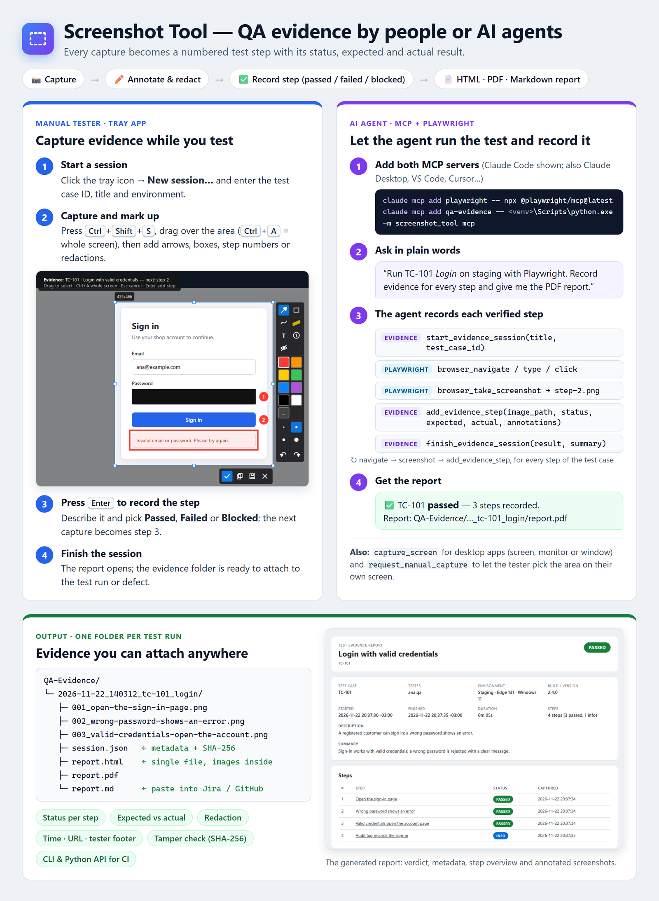

# Screenshot Tool — QA evidence capture

A lightweight screenshot and annotation tool, written in Python + PyQt6, that turns captures into **QA test evidence**:
numbered steps with a status (passed / failed / blocked), expected and actual results, and a ready-to-attach
**HTML, PDF or Markdown report**.

Use it in three ways:

- **Manual testers**: press a hotkey, select an area, mark it up, press Enter. Each capture becomes the next test step.
- **AI agents (MCP)**: an MCP server lets Claude, Copilot, Cursor and other agents record evidence while they drive
  the application with [Playwright MCP](https://github.com/microsoft/playwright-mcp) or other tools.
- **Automation and CI**: a Python API and a command line for Playwright, pytest, Cypress, Selenium or shell scripts.



## Contents

- [Features](#features)
- [Installation](#installation)
- [Manual testing with the tray app](#manual-testing-with-the-tray-app)
- [AI agents: the MCP server](#ai-agents-the-mcp-server)
- [Automation: Python API and CLI](#automation-python-api-and-cli)
- [Evidence sessions and reports](#evidence-sessions-and-reports)
- [Configuration](#configuration)
- [Building a standalone Windows executable](#building-a-standalone-windows-executable)
- [Development](#development)

## Features

- Selects regions across all monitors, including mixed-DPI setups (`Ctrl+A` selects the whole screen)
- Annotation tools: arrow, rectangle, pen, highlighter, text, **numbered step badges** and **redaction** (opaque boxes
  that hide passwords or personal data)
- **Evidence sessions**: one folder per test run, with numbered steps, a status, expected and actual results, and notes
- **Evidence footer** on every screenshot: test case, capture time with UTC offset, URL, tester and environment
- **Reports**: a self-contained HTML file with the images embedded, a PDF (one page per screenshot) and Markdown
- **Integrity**: every image's SHA-256 is recorded, and reports flag files that changed after capture
- **MCP server** with 12 tools and a prompt, designed to work alongside Playwright MCP, including a
  *human-in-the-loop* capture that the agent can request from the tester
- Copy to the clipboard or save as PNG / JPG, global hotkey (default `Ctrl+Shift+S`), system tray icon, JSON config

## Installation

### Windows executable

You don't need Python to use the app on Windows:

1. Download `ScreenshotTool.exe` from the [Releases](../../releases) page.
2. Double-click it. A capture opens immediately and the app stays in the system tray.
3. Press `Ctrl+Shift+S` whenever you want to take another screenshot.

To start it automatically when you log in, press `Win+R`, type `shell:startup`, and put a shortcut to the exe in that
folder. The same exe also runs the MCP server (`ScreenshotTool.exe mcp`, see [below](#ai-agents-the-mcp-server)).

### From source

Requirements: Python 3.10+ on Windows, macOS, or Linux with an **X11** session (Wayland blocks global hotkeys and
screen capture).

```bash
git clone https://github.com/ram-ai-wq/python-print-screen.git
cd python-print-screen
python -m venv .venv
```

Activate the virtual environment:

| OS | Command |
|----|---------|
| Windows (PowerShell) | `.\.venv\Scripts\Activate.ps1` |
| macOS / Linux | `source .venv/bin/activate` |

Then install the dependencies, and the package itself so that MCP clients can start it from any folder:

```bash
pip install -r requirements.txt
pip install -e .
```

`pip install -e .` also adds three commands to the environment: `screenshot-tool` (the tray app),
`screenshot-tool-mcp` (the MCP server) and `screenshot-evidence` (the evidence CLI).

## Manual testing with the tray app

Run the app **from the project root** (or use the exe):

```bash
python -m screenshot_tool               # capture now and keep running in the tray
python -m screenshot_tool --background  # start in the tray only
```

### Record evidence for a test case

1. **Start a session.** Click the tray icon (or right-click it → *New evidence session…*) and enter the test case ID,
   title, tester, environment and build. The environment and build are prefilled from your previous session.
2. **Capture.** Press `Ctrl+Shift+S` and drag over the area, or press `Ctrl+A` for the whole screen. The banner at the
   top shows the session and the next step number.
3. **Mark it up.** Use the arrow, rectangle, step-number or redaction tools to point at what matters and hide sensitive
   data.
4. **Record the step.** Press `Enter` (or the blue ✓ button), type what the step shows, choose **Passed**, **Failed**,
   **Blocked**, **Skipped** or **Info** (`Alt+P/F/B/S/I`), and optionally fill in the expected and actual results. The
   next step starts with the same status.
5. **Repeat** for every step. The **session window** (click the tray icon) lists the steps with thumbnails. Use it to
   edit, delete or reorder steps, or to add a text-only step such as a database check.
6. **Finish.** Choose *Finish…*, confirm the overall result (derived from the steps), write a summary and pick the
   report formats. The report opens when it is ready.

The active session survives restarts: if you quit the app, it resumes the unfinished session next time. Without a
session the tool works as a plain screenshot tool (copy or save).

### Keyboard shortcuts in the capture overlay

| Key | Action |
|-----|--------|
| Drag | Select an area (drag the handles to resize, drag inside to move) |
| `Ctrl+A` | Select the whole screen under the mouse cursor |
| `Enter` | Add the selection as the next evidence step (when a session is active) |
| `Ctrl+C` / `Ctrl+S` | Copy to the clipboard / save to a file |
| `Ctrl+Z` / `Ctrl+Y` | Undo / redo the last annotation |
| `Esc` | Close the overlay |

Other options: `--once` (capture once, then exit), `--session <folder or ID>` (start with that session active),
`--config PATH`, `-v` (debug logging) and `--version`.

## AI agents: the MCP server

The tool includes an **MCP (Model Context Protocol)** server, `qa-evidence`. Any MCP client (Claude Code, Claude
Desktop, VS Code / GitHub Copilot, Cursor and others) can use it to record test evidence. Pair it with
**Playwright MCP**: Playwright drives the browser, `qa-evidence` records what was verified.

```bash
python -m screenshot_tool mcp        # stdio transport (what MCP clients launch)
```

| Option | Description |
|--------|-------------|
| `--evidence-dir DIR` | Where sessions are written (also `QA_EVIDENCE_DIR`; default: `evidence_folder` in the config, or `Documents/QA-Evidence`) |
| `--workspace DIR` | Extra folder for resolving relative screenshot paths (repeatable; also `QA_EVIDENCE_WORKSPACE`) |
| `--config PATH` | Use a specific `config.json` |
| `-v` | Debug logging to stderr |

### Connect it to your MCP client

Use the Python from the virtual environment where you ran `pip install -e .`, or the Windows exe.

**Claude Code**

```bash
claude mcp add playwright -- npx @playwright/mcp@latest
claude mcp add qa-evidence -- C:\path\to\python-print-screen\.venv\Scripts\python.exe -m screenshot_tool mcp
```

**Claude Desktop** (`%APPDATA%\Claude\claude_desktop_config.json` on Windows,
`~/Library/Application Support/Claude/claude_desktop_config.json` on macOS):

```json
{
  "mcpServers": {
    "playwright": {
      "command": "npx",
      "args": ["@playwright/mcp@latest"]
    },
    "qa-evidence": {
      "command": "C:\\path\\to\\python-print-screen\\.venv\\Scripts\\python.exe",
      "args": ["-m", "screenshot_tool", "mcp"]
    }
  }
}
```

With the Windows exe, no Python is needed: `"command": "C:\\Tools\\ScreenshotTool.exe", "args": ["mcp"]`.

**VS Code** (`.vscode/mcp.json`):

```json
{
  "servers": {
    "playwright": { "type": "stdio", "command": "npx", "args": ["@playwright/mcp@latest"] },
    "qa-evidence": {
      "type": "stdio",
      "command": "C:\\path\\to\\python-print-screen\\.venv\\Scripts\\python.exe",
      "args": ["-m", "screenshot_tool", "mcp"]
    }
  }
}
```

On macOS and Linux use `.venv/bin/python` instead of `.venv\Scripts\python.exe`.

### Ask for a test run

Describe the test in plain words, for example:

> Run test case TC-101 "Login" on https://staging.example.com with Playwright: open the sign-in page, try a wrong
> password, then sign in as the demo user. Record evidence for every step with the qa-evidence tools (expected vs actual,
> passed/failed), redact the password, and give me the PDF report.

The agent calls `start_evidence_session`, performs each step with Playwright, takes a screenshot with
`browser_take_screenshot`, records it with `add_evidence_step`, and finally calls `finish_evidence_session` and replies
with the report paths. Clients that support MCP prompts also offer a `test_with_evidence` prompt (in Claude Code:
`/mcp__qa-evidence__test_with_evidence`).

To try it safely, serve the bundled demo shop with `python -m http.server 8000 --directory examples/demo-site` and
test `http://localhost:8000` (valid login: `ana@example.com` / `correct-horse`).

### Tools

| Tool | What it does |
|------|--------------|
| `start_evidence_session` | Start a session for a test case (title, test case ID, environment, build, tester) |
| `add_evidence_step` | Record a step from an image file (e.g. a Playwright screenshot) or as text only; optional annotations |
| `capture_screen` | Capture the real screen (whole desktop, a monitor, a window by title/process, or a region) as a step |
| `request_manual_capture` | Open the capture overlay on the tester's screen with the agent's instructions and wait for their selection |
| `update_evidence_step` / `delete_evidence_step` | Fix a step's text or status, or remove a wrong capture (later steps are renumbered) |
| `finish_evidence_session` | Set the overall result and summary, and write the reports |
| `generate_evidence_report` | Write or refresh reports without changing the result |
| `get_evidence_session` / `list_evidence_sessions` / `open_evidence_session` | Inspect sessions, or continue an earlier one |
| `list_capture_targets` | List monitors and (on Windows) open windows |

Annotations are objects with a `type` (`rect`, `highlight`, `arrow`, `text`, `step`, `redact`) and pixel coordinates
of the image, for example `{"type": "rect", "x": 459, "y": 464, "width": 362, "height": 51, "label": "Error message"}`.

Tips for agents working with Playwright MCP:

- Playwright saves `browser_take_screenshot` files relative to its workspace and prints that relative path.
  `add_evidence_step` resolves relative paths against the same folder (the directory the client starts servers in,
  plus `--workspace` folders). Set `delete_source_file` to move the file into the session instead of copying it.
- Start Playwright MCP with `--snapshot-boxes` to get element bounding boxes. For viewport screenshots they are already
  image pixels, ready to use as annotation coordinates.
- Pass `include_image: true` to get a downscaled preview of the saved step back, to check what was recorded.

**Privacy:** everything stays on your machine. The server can capture the screen and list window titles; images go back
to the model only when `include_image` is set. Use `redact` annotations for secrets and personal data.

## Automation: Python API and CLI

### Python (Playwright, pytest...)

```python
from screenshot_tool.evidence import EvidenceSession

session = EvidenceSession.create("evidence", "Login with valid credentials", test_case_id="TC-101",
                                 environment="Chromium headless")
page.goto("https://staging.example.com/login")
session.add_step(page.screenshot(), title="Open the sign-in page", status="passed",
                 expected="Sign-in form is shown", actual="Form shown", url=page.url)

error = page.get_by_role("alert")
box = error.bounding_box()
session.add_step(page.screenshot(), title="Wrong password shows an error", status="passed",
                 annotations=[{"type": "rect", "label": "Error message", **box}])

session.finish(summary="Login works")          # result derived from the steps, or pass result="failed"
session.export(["html", "pdf", "md"])           # writes report.* into the session folder
```

`add_step` accepts PNG/JPEG bytes, a file path, a `QImage`, a Pillow image or `None` (text-only step). Sessions can be
reopened with `EvidenceSession.open(folder)` and edited with `update_step`, `delete_step` and `move_step`.

A complete runnable example, which tests the bundled demo site, is in
[`examples/playwright_evidence.py`](examples/playwright_evidence.py):

```bash
pip install playwright
python examples/playwright_evidence.py --channel msedge   # or --channel chrome, or run `playwright install chromium` first
```

### Command line (any language or framework)

```bash
SESSION=$(python -m screenshot_tool evidence new --title "Login" --test-case TC-101 --environment "CI" --print-path)
python -m screenshot_tool evidence add "$SESSION" --image shot.png --title "Login page" --status passed \
       --expected "Form shown" --actual "Form shown" --annotations '[{"type":"redact","x":463,"y":344,"width":354,"height":44}]'
python -m screenshot_tool evidence add "$SESSION" --title "Order stored" --status passed --notes "orders.id=42"
python -m screenshot_tool evidence capture "$SESSION" --title "Desktop app" --window "Notepad"
python -m screenshot_tool evidence finish "$SESSION" --summary "All checks passed" --format html,pdf
```

Other commands: `report`, `show` and `list`. Output is JSON (`--print-path` prints only the folder), errors go to
stderr with exit code 1, and `--evidence-dir` or `QA_EVIDENCE_DIR` selects where sessions are stored. With
`pip install -e .` the command is also available as `screenshot-evidence`.

## Evidence sessions and reports

Each test run is one folder (by default under `Documents/QA-Evidence`):

```text
2026-11-22_140312_tc-101_login-with-valid-credentials/
├── session.json                          # metadata, steps, SHA-256 of every image
├── 001_open-the-sign-in-page.png
├── 002_wrong-password-shows-an-error.png
├── report.html                           # single file with the images embedded
├── report.pdf                            # A4, a summary page plus one page per screenshot
└── report.md                             # paste into Jira, GitHub or Azure DevOps (keep the images next to it)
```

- **Statuses:** `passed`, `failed`, `blocked`, `skipped` and `info` (aliases such as `pass`, `fail` or `n/a` are
  accepted). The overall result defaults to *failed* if any step failed, then *blocked*, then *passed*.
- **Footer:** screenshots get an evidence bar below the image with the test case, the capture time with UTC offset, the
  URL, the tester and the environment. Turn it off per session or with `stamp_images` in the config.
- **Integrity:** the SHA-256 of each image is stored when it is captured. Reports recompute it and show
  *"modified since capture"* if a file was edited afterwards.
- **Numbering:** deleting or reordering steps renames the image files to match the new numbers.
- **Shared sessions:** the tray app, an AI agent and scripts can work on the same session at the same time. Updates
  are serialised with a lock file, and every step has a stable ID, so an outdated view never edits the wrong step.
- Sessions are plain folders: zip one and attach it, or open it from the tray app or MCP later to add more steps.
  When a session is opened, `session.json` is validated, so a received session cannot refer to files outside its
  folder.

## Configuration

The app creates a `config.json` file the first time it runs:

| OS | Location |
|----|----------|
| Windows | `%APPDATA%\screenshot_tool\config.json` |
| macOS | `~/Library/Application Support/screenshot_tool/config.json` |
| Linux | `$XDG_CONFIG_HOME/screenshot_tool/config.json` (default `~/.config/...`) |

```json
{
  "hotkey": "ctrl+shift+s",
  "default_color": "#ff3b30",
  "thickness": 4,
  "save_folder": "",
  "evidence_folder": "",
  "tester": "",
  "report_formats": ["html", "pdf", "md"],
  "stamp_images": true,
  "ask_step_details": true
}
```

- `hotkey`: modifiers (`ctrl`, `shift`, `alt`, `cmd`/`win`) and one key joined with `+`, for example `ctrl+alt+p` or `print_screen`
- `default_color`: a `#rrggbb` color
- `thickness`: an integer from 1 to 50
- `save_folder`: the default folder for the save dialog. If left empty, it uses `~/Pictures`
- `evidence_folder`: where evidence sessions are stored. If left empty, it uses `Documents/QA-Evidence`
- `tester`: the name recorded as the tester. If left empty, it uses the operating-system user name
- `report_formats`: the formats selected by default when a session is finished (`html`, `pdf`, `md`)
- `stamp_images`: add the evidence footer to new screenshots
- `ask_step_details`: show the step dialog when adding a step. If `false`, `Enter` adds the step immediately

Any invalid value is ignored and falls back to its default. The app also stores the active session as `active_session`.

## Building a standalone Windows executable

From the project root in PowerShell:

```powershell
.\build_exe.ps1
```

If script execution is blocked, run `powershell -ExecutionPolicy Bypass -File .\build_exe.ps1` instead.

The script installs the dependencies and [PyInstaller](https://pyinstaller.org) into the active environment (or `.venv`
if it exists). It then writes a single-file, windowless executable to `dist\ScreenshotTool.exe`. Python is not needed on
the machine that runs the exe. The exe is both the tray app and the MCP server (`ScreenshotTool.exe mcp`).

> Some antivirus products flag unsigned PyInstaller executables. To avoid that when distributing the exe, code-sign it.

## Platform notes

- **macOS:** grant *Screen Recording* and *Accessibility / Input Monitoring* permissions to the app (or to your
  terminal) in System Settings › Privacy & Security, then restart it.
- **Linux:** needs an X11 session. On Wayland, the global hotkey and screen capture will not work.
- **Window capture** (`capture_screen` / `evidence capture --window`) is available on Windows. On other systems,
  capture a monitor or a region instead.

## Development

```bash
pip install -r requirements.txt
python -m pytest
```

The tests run headless (Qt's `offscreen` platform). They include an end-to-end MCP test that starts the server over
stdio, as an MCP client would.

Project layout:

```text
screenshot_tool/
├── __main__.py    # entry point: tray app, `mcp` and `evidence` sub-commands
├── app.py         # tray app: hotkey, tray menu, evidence-session lifecycle
├── overlay.py     # full-screen selection / annotation window
├── toolbar.py     # annotation toolbar and action bar
├── tools.py       # annotation shapes (including step badges and redaction)
├── session_ui.py  # step, new-session and finish dialogs, and the session window
├── evidence.py    # evidence sessions: steps, numbering, manifest, hashes (no GUI)
├── report.py      # HTML, Markdown and PDF reports
├── render.py      # headless image helpers: loading, annotations, evidence footer
├── mcp_server.py  # MCP server for AI agents
├── cli.py         # `evidence` command line for scripts and CI
├── screens.py     # headless capture: monitors, regions, windows (Windows)
├── capture.py     # overlay screen capture (mss) and coordinate helpers
├── storage.py     # image composition, clipboard and file output
├── config.py      # JSON configuration
├── hotkey.py      # global hotkey (pynput)
└── qt_runtime.py  # windowless Qt application for headless rendering
examples/          # Playwright example and a demo site to test against
docs/images/       # README images
tests/             # pytest suite
build_exe.ps1      # Windows executable build script
```

## Troubleshooting

**`ModuleNotFoundError: No module named 'screenshot_tool'`**: you ran `python __main__.py` from inside the package, or
an MCP client started the server from another folder without the package installed. Run `python -m screenshot_tool`
from the project root, or run `pip install -e .` in the virtual environment.

**The hotkey does nothing**: another app may already be using that key combination. Choose a different `hotkey` in
`config.json`.

**The agent says "No active evidence session"**: it must call `start_evidence_session` (or `open_evidence_session`)
before recording steps.

**The agent says "Image file not found"**: the screenshot path is relative to a folder the server does not know. Pass
an absolute path, or start the server with `--workspace <folder where the screenshots are saved>`.

**"Could not replace report.pdf"**: the PDF is open in a viewer that locks it. Close it and create the report again.

**The MCP server does not start**: check the client's MCP logs. Run the configured command yourself; it should wait
silently for input (stop it with `Ctrl+C`). If it says the `mcp` package is missing, run
`pip install -r requirements.txt`.

## Contributing

Issues and pull requests are welcome. Please run `python -m pytest` before submitting.

## License

[Apache License 2.0](LICENSE)
